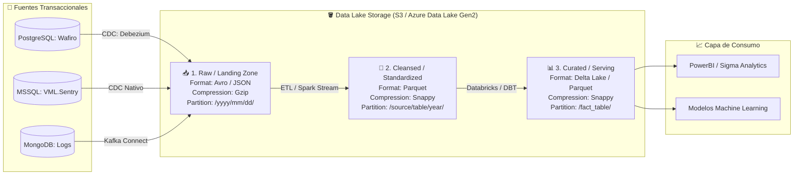
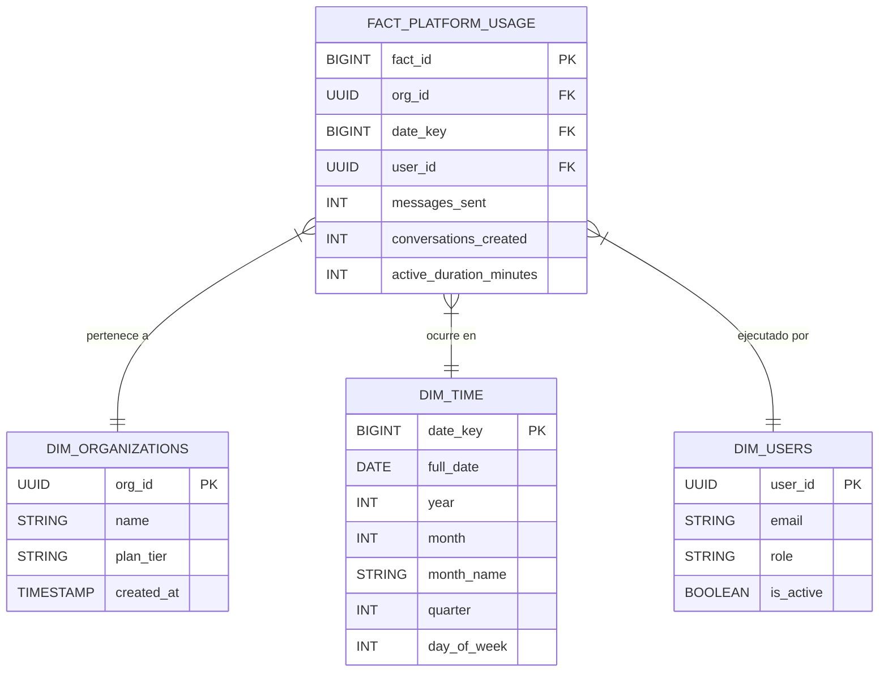

# 🏗️ Módulo 4.1 - Arquitectura de Data Lake Corporativo (VML Technologies)

## T1: Diagrama de Flujo y Topología de Datos
A continuación se detalla la arquitectura de ingesta continua desde las fuentes transaccionales heterogéneas hacia las tres zonas fundamentales del Data Lake.

### Especificación Técnica por Zona de Datos:
1. **Raw / Landing Zone:** Recibe los datos crudos en tiempo real de CDC. Se utiliza **Apache Avro** o JSON debido a su alta velocidad de escritura y soporte nativo para esquemas evolutivos rápidos. Compresión **Gzip** para maximizar ahorro de espacio.
2. **Cleansed / Standardized Zone:** Datos limpios con tipos unificados, remoción de nulos e IP/User Agents normalizados. Formato **Apache Parquet** orientado a columnas. Compresión **Snappy** balanceando velocidad de descompresión analítica frente a almacenamiento.
3. **Curated / Serving Zone:** Datos estructurados bajo modelado estrella multidimensional. Se implementa en formato **Delta Lake** para asegurar propiedades ACID, control de versiones de datos (*Time Travel*) y optimizaciones mediante *Z-Ordering*.

---

## T2: Esquema Estrella (Star Schema) - Uso de la Plataforma Wafiro
Modelo dimensional optimizado para herramientas OLAP que responde por el volumen de mensajes, conversaciones y usuarios activos por organización en un periodo determinado.

